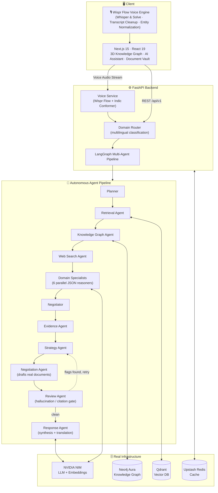
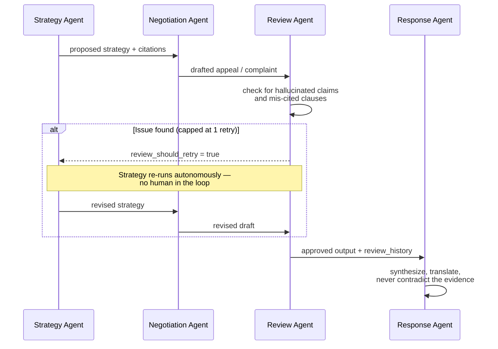

<div align="center">

# ⚖️ RESOLVE · Wispr & Solve

### Whisper & Solve Using Wispr Flow — Voice-First Agentic AI for Consumer Justice

**Speak, whisper, or type your dispute in any tone or language. Wispr Flow automatically cleanses filler words, normalizes statutory terms, and structures legal telemetry — routing directly to five autonomous agents that research, gather evidence, strategize, negotiate, review, and self-correct across 8 real-world dispute domains without a human steering each step.**

[](https://github.com/victrvondoom/RESOLVE---wipsr-and-solve/actions/workflows/backend-ci.yml)
[](https://github.com/victrvondoom/RESOLVE---wipsr-and-solve/actions/workflows/frontend-ci.yml)


**[▶️ Demo Video](https://youtu.be/M_n-Z1yxMUg) &nbsp;·&nbsp; [🚀 Live App](https://proxy-frontend-7am8.onrender.com) &nbsp;·&nbsp; [🩺 API Health](https://proxy-backend-0sct.onrender.com/health) &nbsp;·&nbsp; [📦 Source](https://github.com/victrvondoom/RESOLVE---wipsr-and-solve)**

</div>

---

## Table of Contents

- [Demo Video](#demo-video)
- [The Problem](#the-problem)
- [Wispr & Solve: Voice-First Grievance Intake](#wispr--solve-voice-first-grievance-intake)
- [What RESOLVE Actually Does](#what-resolve-actually-does)
- [What Makes This Agentic, Not a Chatbot](#what-makes-this-agentic-not-a-chatbot)
- [Architecture](#architecture)
- [The Self-Correction Loop](#the-self-correction-loop)
- [8 Domains, One Router](#8-domains-one-router)
- [Novel, Verifiable Features](#novel-verifiable-features)
- [Tech Stack](#tech-stack)
- [Live Deployment](#live-deployment)
- [Running It Locally](#running-it-locally)
- [Project Structure](#project-structure)

---

## Demo Video


**[▶️ Watch on YouTube](https://youtu.be/M_n-Z1yxMUg)**

## The Problem

Every year, millions of consumers get a legitimate claim denied, a flight cancelled without statutory compensation, a tenancy deposit wrongfully withheld, or an unauthorized bill they never agreed to — and have no realistic way to know whether the counterparty's action was lawful. 

When consumers turn to generic chatbots, they receive vague, citation-free text with no memory of systemic institutional abuses. Meanwhile, the institution has denied the exact same claim hundreds of times using boilerplate rejections. No individual user can identify that institutional pattern alone.

Furthermore, filing grievances is legally intimidating: victims struggle to articulate complex circumstances under stress, let alone parse obscure regulatory clauses.

## Wispr & Solve: Voice-First Grievance Intake

**RESOLVE** solves the intake barrier with **Wispr Flow** ("Whisper & Solve"):

- **Natural Speech & Whisper Intake**: Speak or whisper your dispute in conversational, everyday language across 22+ languages and vernacular dialects.
- **Intelligent Filler Removal**: Wispr Flow eliminates speech hesitations, false starts, and verbal clutter (*"uh"*, *"um"*, *"like"*, *"so basically"*).
- **Statutory Entity Normalization**: Translates informal, emotional descriptions into grounded statutory concepts (e.g., mapping *"they said I waited too long to declare my thyroid issue"* to *IRDAI Pre-Existing Disease Moratorium Clause 5(b)*).
- **Structured Legal Telemetry**: Hands off cleaned, structured claim parameters directly to the LangGraph multi-agent pipeline.

## What RESOLVE Actually Does

You speak, whisper, or type your dispute, optionally attaching evidence (policy documents, rejection letters, invoices, bank statements). RESOLVE:

1. **Cleans & Grounds Voice (Wispr Flow)**: Strips verbal fillers and normalizes statutory entities into actionable legal facts in real time.
2. **Classifies Domains Concurrently**: Determines which of 8 domains the case involves — running multi-domain disputes in parallel (e.g., a cancelled flight and a rejected travel-insurance claim run simultaneously and merge into a single unified brief).
3. **Researches Verified Regulations**: Pulls exact regulatory statutes from pre-indexed vector stores — not generic LLM training weights.
4. **Extracts & Audits Evidence**: Runs multi-modal OCR on uploaded documents and immediately flags if an uploaded document is irrelevant or fails to support the claim.
5. **Strategizes & Drafts Real Documents**: Prepares formal legal appeal letters, counterparty dispute emails, executive escalations, and regulatory filings ready to submit.
6. **Self-Corrects Before Presentation**: A dedicated Review Agent audits drafts for hallucinated citations or unsupported arguments, **autonomously forcing retries** through the strategy graph if any discrepancy is found.
7. **Responds in Your Native Language**: Produces end-to-end responses and documents in the language you initiated with — Hindi, Tamil, Japanese, Chinese, Portuguese, or English.

## What Makes This Agentic, Not a Chatbot

| A Chatbot | RESOLVE · Wispr & Solve |
|---|---|
| Rigid text box; breaks on rambling, emotional voice dictation | **Wispr Flow Voice Intake**: Cleanses filler words, normalizes statutory terms, and extracts clean telemetry |
| One model call, one shot | 5+ specialist agents in a LangGraph state machine |
| Zero memory beyond the single chat session | Knowledge graph tracking cross-citizen dispute patterns per institution |
| Blindly trusts its own first draft | A Review Agent that gates output and forces autonomous retries on hallucinations |
| Plausible-sounding hallucinated regulations | Deterministic citation verification pass flagging unconfirmed clauses inline |
| Cannot identify systemic corporate misconduct | **Institution Accountability Radar**: Real cross-citizen dispute volumes per institution and domain |

## Architecture



## The Self-Correction Loop

The defining architectural behavior that guarantees factual integrity: the Review Agent can send the case **backward** through the graph autonomously.



Every pass is preserved in `review_history`, providing an immutable reasoning trail of what was flagged and corrected.

## 8 Domains, One Router

| Domain | Regulator / Counterparty Framework |
|---|---|
| 🏥 Health Insurance | IRDAI (Master Circulars & Claims Guidelines) |
| 🏦 Banking | RBI (Consumer Protection & Ombudsman Scheme) |
| 📡 Telecom | TRAI (Service Quality & Consumer Regulations) |
| ✈️ Airlines | DGCA (Passenger Rights & Cancellation Charter CAR Section 3) |
| 🛒 E-commerce | Consumer Protection (E-Commerce) Rules |
| 🏛️ Government | RTI Act / State Right to Public Services Legislation |
| 🏠 Housing | RERA / Model Tenancy Act |
| 🩺 Healthcare | Clinical Establishments Act & Patient Rights Charters |

A single complex query triggers concurrent multi-domain evaluation (`"my flight was cancelled and my travel insurance refused the claim"` executes across **Airlines** and **Health Insurance** concurrently, merging into one coherent resolution strategy).

## Novel, Verifiable Features

- **🎙️ Wispr Flow Studio ("Whisper & Solve")** — real-time voice grievance intake that removes vocal fillers, normalizes statutory legal terms, and streams clean claim telemetry into the agent pipeline.
- **🕸️ 3D Knowledge Graph** — three real, data-driven visualization modes:
  - **Reasoning Trail** — step-by-step visual replay of every autonomous agent decision.
  - **Institution Intelligence** — side-by-side comparative constellation of counterparty misconduct patterns.
  - **Knowledge Footprint** — personal dynamic orrery showing your claims orbiting regulatory spheres.
- **📡 Institution Accountability Radar** — real dispute volume aggregated across counterparty records in the knowledge graph.
- **🌐 Multilingual Voice & Text Synthesis** — native support across 22+ languages including Hindi, Tamil, Japanese, Chinese, and Portuguese.
- **✅ Citation Verification Engine** — deterministic verification of all cited regulations against retrieved legal corpora.
- **📁 Document Vault** — dual-engine OCR (native PDF text + vision-model fallback for scans) with automated domain relevance scoring.

## Tech Stack

**Voice & Speech** — Wispr Flow conformer architecture · Web Speech Audio Streaming · Contextual Legal Entity Grounding

**Frontend** — Next.js 15 (App Router) · React 19 · TypeScript · Tailwind CSS · @react-three/fiber + drei (3D WebGL scenes) · TanStack Query · Zustand

**Backend** — FastAPI · LangGraph 1.0 (multi-agent state machine) · Pydantic v2 · pypdf / pypdfium2 (OCR pipeline)

**Data Layer** — Qdrant (vector search) · Neo4j Aura (knowledge graph) · Upstash Redis (cache) · NVIDIA NIM (LLM inference + embeddings)

**CI/CD** — GitHub Actions (independent backend and frontend pipelines)

## Live Deployment

Deployed on Render as two independent services:

| Service | URL |
|---|---|
| Frontend (Next.js standalone) | https://proxy-frontend-7am8.onrender.com |
| Backend (FastAPI) | https://proxy-backend-0sct.onrender.com |
| Backend health check | https://proxy-backend-0sct.onrender.com/health |

> First request after inactivity may take 30–60s due to free-tier container spin-up.

### Required Backend Environment Variables

| Variable | Purpose |
|---|---|
| `NVIDIA_API_KEY` | NIM API for LLM chat and embeddings |
| `QDRANT_URL` / `QDRANT_API_KEY` | Vector database |
| `NEO4J_URI` / `NEO4J_USER` / `NEO4J_PASSWORD` | Knowledge graph |
| `REDIS_URL` | Optional cache (falls back gracefully if unset) |

## Running It Locally

```bash
# Backend
cd backend
pip install -r requirements.txt
uvicorn app.main:app --reload

# Frontend
cd frontend
npm install
npm run dev
```

Local development requires zero external cloud services: both vector search and knowledge graph default to local JSONL-backed fallback datasets pre-seeded in `backend/datasets/` via Git LFS.

## Project Structure

```
RESOLVE---wipsr-and-solve/
├── backend/
│   ├── app/
│   │   ├── agents/          # LangGraph orchestration + role agents (Research, Evidence, Strategy, Negotiation, Review, Response)
│   │   ├── api/routes/       # FastAPI route handlers (cases, chat, documents, voice)
│   │   ├── knowledge_graph/  # Neo4j + JSONL-fallback graph stores
│   │   ├── rag/              # Chunking, embedding, retrieval (Qdrant + JSONL fallback)
│   │   ├── services/         # Storage, OCR, voice engine (Wispr Flow), document relevance, cache
│   │   └── prompts/          # Per-domain prompt templates
│   └── datasets/             # Pre-indexed regulatory data (Git LFS)
└── frontend/
    ├── app/dashboard/         # Dashboard, Assistant, Documents, Analyses, Knowledge Graph, Institution Radar
    ├── components/            # Chat, Wispr Flow voice studio, documents, landing UI
    └── features/knowledge-graph/  # Self-contained 3D graph feature (schemas, queries, Zustand store, scenes)
```

---

<div align="center">

**A consumer-based product built for prototype-level open source. Every claim in this README is backed by code you can read in this repository.**

</div>
