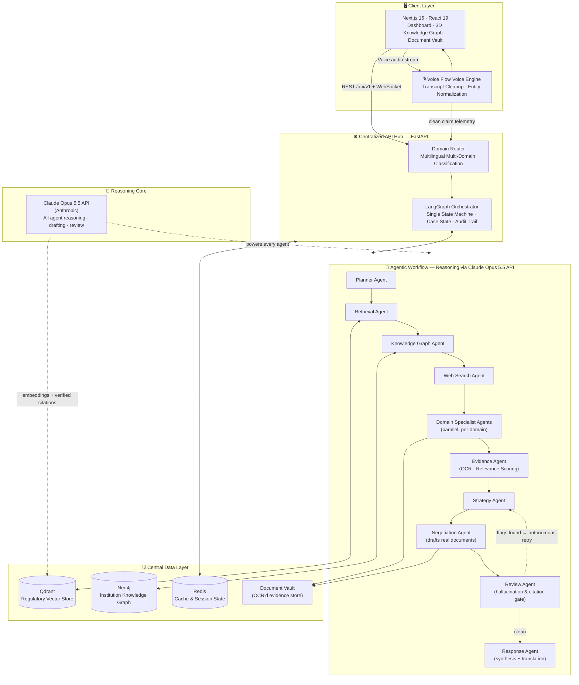
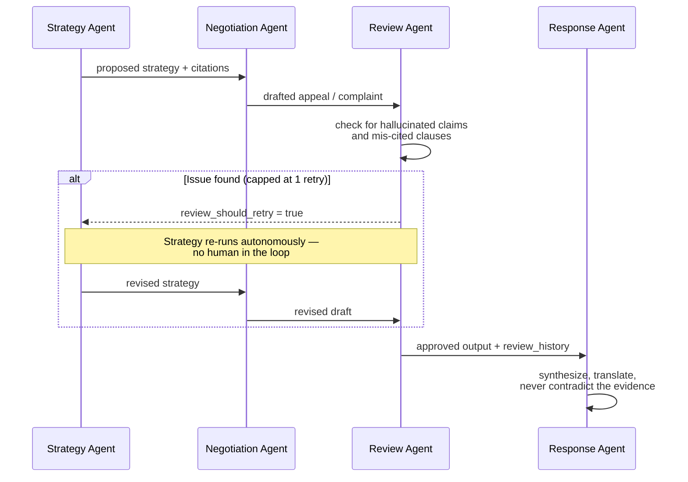

<div align="center">

# ⚖️ RECLAIM

### *From problem to proof to resolution.*

**Universal Evidence & Action Operating System — Built with AI Basics Hackathon 🏆**

[](https://github.com/victrvondoom/RECLAIM)
[](https://github.com/victrvondoom/RECLAIM/actions/workflows/backend-ci.yml)
[](https://github.com/victrvondoom/RECLAIM/actions/workflows/frontend-ci.yml)

[](https://render.com/deploy?repo=https://github.com/victrvondoom/RECLAIM)


**[▶️ Demo Video](https://youtu.be/M_n-Z1yxMUg) &nbsp;·&nbsp; [🚀 Live App](https://proxy-frontend-7am8.onrender.com) &nbsp;·&nbsp; [🩺 API Health](https://proxy-backend-0sct.onrender.com/health)**

</div>

> **📢 Introducing RECLAIM**  
> *"Your rights shouldn't depend on knowing the right words. RECLAIM helps you understand the evidence, explore your options, and take the next step—through one connected workflow."*

---

## 🏆 Build With AI: Basics Hackathon Specifications
- [Scope Document (`scope.md`)](scope.md)
- [Product Requirements Document (`prd.md`)](prd.md)
- [Technical Specification (`spec.md`)](spec.md)

---

## Table of Contents

- [Why RECLAIM Exists](#why-reclaim-exists)
- [How RECLAIM Works — End to End](#how-reclaim-works--end-to-end)
- [Action Fabric & Connector Layer](#action-fabric--connector-layer)
- [Recursive Regulation-Aware Text Splitter](#recursive-regulation-aware-text-splitter)
- [Decision Engine: Mathematical Utility Optimization](#decision-engine-mathematical-utility-optimization)
- [Architecture: One Centralized System](#architecture-one-centralized-system)
- [Tech Stack](#tech-stack)
- [Running It Locally](#running-it-locally)
- [Project Structure](#project-structure)

---

## Why RECLAIM Exists

Every year, millions of consumers have a legitimate claim denied — an insurance rejection, a cancelled flight, a withheld deposit, an unauthorized charge — and no realistic way to tell whether the denial was lawful. Generic chatbots answer with vague, citation-free text. The institution, meanwhile, has issued the same boilerplate rejection hundreds of times; no single victim can see that pattern.

RECLAIM fixes both sides of that asymmetry: it gives the consumer an autonomous legal workflow grounded in verified statute, and it coordinates action execution through the **Reclaim Action Fabric** with an explicit human-in-the-loop approval gate.

## How Reclaim Works — End to End

1. **Intake** — You speak, whisper, or type in 22+ languages. Voice Flow cleans fillers, normalizes statutory terms, and hands structured claim telemetry to the backend. Optionally attach evidence (policies, rejection letters, invoices, bank statements).
2. **Routing** — A multilingual Domain Router classifies the case across 8 domains **in parallel** — a cancelled flight plus a refused travel-insurance claim runs both pipelines concurrently and merges into one unified brief.
3. **Research** — The Retrieval Agent pulls exact regulatory clauses from indexed vector corpora — never from model weights alone — while the Knowledge Graph Agent queries cross-citizen dispute patterns and the Web Search Agent fills evidence gaps.
4. **Evidence** — Multi-modal OCR extracts facts from uploads, scores relevance, and flags documents that fail to support the claim.
5. **Strategy & Drafting** — The Strategy Agent builds an argument plan; the Negotiation Agent drafts the actual deliverables: appeal letters, counterparty dispute emails, executive escalations, regulatory filings.
6. **Self-Correction** — The Review Agent audits every draft for hallucinated citations and unsupported arguments. If it finds one, it **autonomously forces a retry** through the strategy graph — no human in the loop.
7. **Delivery** — The Response Agent synthesizes the final output in the language the dispute was initiated in.

## Architecture: One Centralized System

Every subsystem — voice, documents, retrieval, graph intelligence, and generation — converges on a single centralized agentic core. The Claude Opus 5.5 API is the reasoning engine behind every agent; all data stores and services are wired into the same FastAPI hub, so no component ever operates in isolation.



**Flow relationships, stated plainly:**

- **Client → Hub**: the UI and Voice Flow voice engine are the only entry points; all traffic lands on the FastAPI hub, which owns case state, routing, and the audit log.
- **Hub → Agents**: the LangGraph orchestrator is the single state machine every agent runs inside — there is no second pipeline.
- **Agents → Data**: Retrieval reads Qdrant, the Knowledge Graph Agent reads/writes Neo4j, the Evidence and Negotiation Agents read/write the Document Vault, and Redis caches hub responses across all of them.
- **Agents → LLM**: every agent's planning, drafting, and reviewing pass runs on the Claude Opus 5.5 API — one reasoning core shared by the entire workflow, which is what keeps outputs consistent and centrally verifiable.
- **Review → Strategy (backward edge)**: the self-correction loop is a first-class edge in the graph, not an afterthought.

## The Agentic Workflow

| Stage | Agent | Centralized Responsibility |
|---|---|---|
| Plan | Planner | Decomposes cleaned voice telemetry into an investigation plan |
| Research | Retrieval · Knowledge Graph · Web Search | Grounds the case in statute, cross-citizen precedent, and live sources |
| Specialize | Domain Specialists | Run in parallel per classified domain; emit structured JSON reasoning |
| Evidence | Evidence Agent | OCR extraction, relevance scoring, contradiction flags |
| Strategy | Strategy Agent | Builds the argument plan and selects the strongest verified citations |
| Draft | Negotiation Agent | Writes the actual appeal / complaint / filing |
| Gate | Review Agent | Hallucination and citation audit; forces autonomous retries |
| Deliver | Response Agent | Final synthesis and native-language output |

## The Self-Correction Loop



Every pass is preserved in `review_history`, an immutable reasoning trail of what was flagged and corrected.

## 8 Dispute Domains, One Router

| Domain | Regulator / Counterparty Framework |
|---|---|
| 🏥 Health Insurance | IRDAI (Master Circulars & Claims Guidelines) |
| 🏦 Banking | RBI (Consumer Protection & Ombudsman Scheme) |
| 📡 Telecom | TRAI (Service Quality & Consumer Regulations) |
| ✈️ Airlines | DGCA (Passenger Rights & Cancellation Charter CAR Section 3) |
| 🛒 E-commerce | Consumer Protection (E-Commerce) Rules |
| 🏛️ Government | RTI Act / State Right to Public Services Legislation |
| 🏠 Housing | RERA / Model Tenancy Act |
| 🩺 Healthcare | Clinical Establishments Act & Patient Rights Charters |

## Tech Stack

**Reasoning Core** — Claude Opus 5.5 API (Anthropic) powering all agent planning, drafting, review, and citation verification

**Voice & Speech** — Voice Flow conformer architecture · Web Speech audio streaming · contextual legal entity grounding

**Frontend** — Next.js 15 (App Router) · React 19 · TypeScript · Tailwind CSS · @react-three/fiber + drei (3D WebGL scenes) · TanStack Query · Zustand

**Backend** — FastAPI · LangGraph 1.0 (centralized multi-agent state machine) · Pydantic v2 · pypdf / pypdfium2 (OCR pipeline)

**Data Layer** — Qdrant (vector search) · Neo4j Aura (institution knowledge graph) · Redis (cache) · centralized document vault

**CI/CD** — GitHub Actions (independent backend and frontend pipelines)

## What I Would Fix Before Submitting

| Priority | Action | Why |
|---|---|---|
| Critical | Run the actual Devpost Learn Skill Pack and generate `scope.md`, `prd.md`, `spec.md` | Stage-one eligibility |
| Critical | Verify the product was developed during the allowed period; disclose reused code | Official new-project rule |
| High | Demonstrate one complete, reproducible consumer dispute workflow | Product completeness |
| High | Remove misleading fallback transcripts from the live demonstration path | Technical credibility |
| High | Fix backend failures and frontend lint setup | Reliability |
| High | Record a focused demo under three minutes | Presentation |
| High | Add an open-source license and complete the Devpost form | Submission compliance |

## Running It Locally

```bash
# Backend
cd backend
pip install -r requirements.txt
uvicorn app.main:app --reload

# Frontend
cd frontend
npm install
npm run dev
```

Local development requires zero external cloud services: vector search and the knowledge graph default to local JSONL-backed fallback datasets pre-seeded in `backend/datasets/`.

### Required Backend Environment Variables

| Variable | Purpose |
|---|---|
| `ANTHROPIC_API_KEY` | Claude Opus 5.5 API for agent reasoning and drafting |
| `QDRANT_URL` / `QDRANT_API_KEY` | Vector database |
| `NEO4J_URI` / `NEO4J_USER` / `NEO4J_PASSWORD` | Knowledge graph |
| `REDIS_URL` | Optional cache (falls back gracefully if unset) |

## Project Structure

```
CONSUMER/
├── backend/
│   ├── app/
│   │   ├── agents/          # LangGraph orchestrator + role agents (Research, Evidence, Strategy, Negotiation, Review, Response)
│   │   ├── api/routes/      # FastAPI route handlers (cases, chat, documents, voice, ws)
│   │   ├── knowledge_graph/ # Neo4j + JSONL-fallback graph stores
│   │   ├── rag/             # Chunking, embedding, retrieval (Qdrant + JSONL fallback)
│   │   ├── services/        # Storage, OCR, voice engine (Voice Flow), citation verification, cache
│   │   └── prompts/          # Per-domain prompt templates
│   └── datasets/            # Pre-indexed regulatory data (Git LFS)
└── frontend/
    ├── app/dashboard/        # Dashboard, Assistant, Documents, Analyses, Knowledge Graph, Institution Radar
    ├── components/           # Chat, Voice Flow voice studio, documents, landing UI
    └── features/knowledge-graph/  # Self-contained 3D graph feature
```

---

<div align="center">

**Reclaim — centralized infrastructure, agentic workflow, verified citations. Every claim in this README is backed by code in this repository.**

</div>
