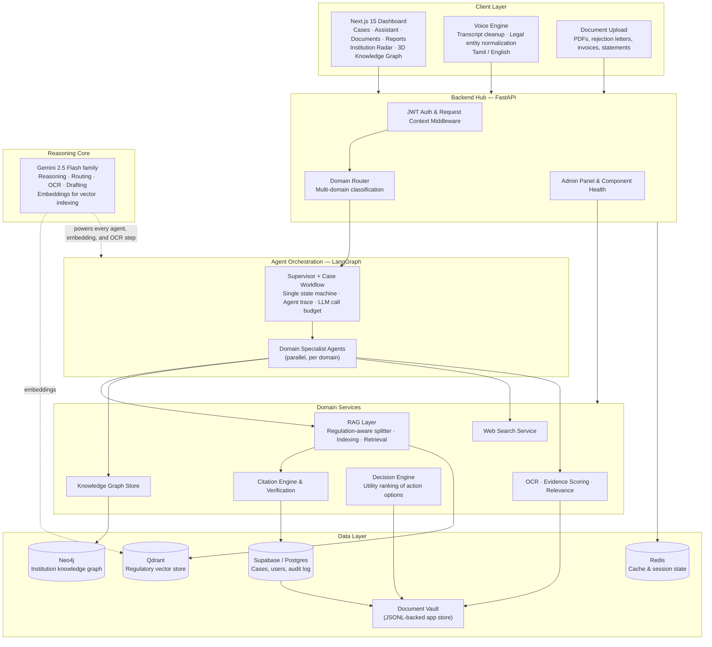
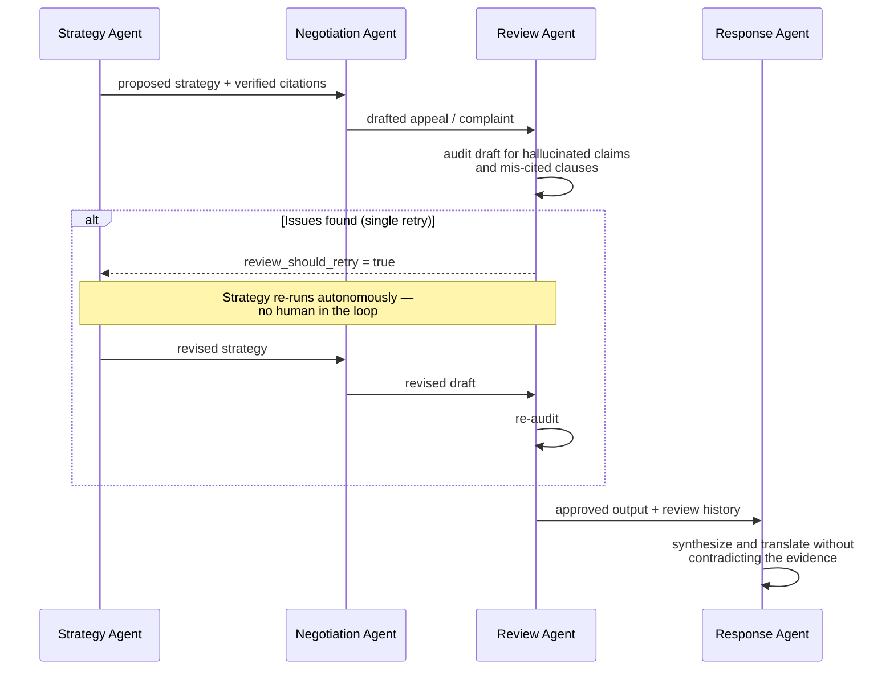
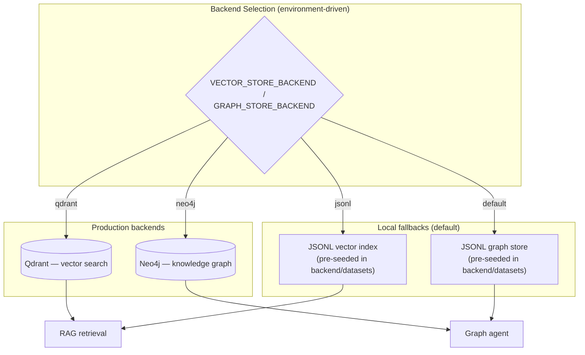

# RECLAIM

**A multi-agent consumer advocacy system that turns a rejected claim into a grounded, citable, ready-to-send dispute — across eight consumer domains.**

RECLAIM helps a consumer who has been denied a claim (an insurance rejection, a cancelled flight, a hidden bank charge) understand whether the denial was lawful and produce the actual documents needed to fight it. Instead of a generic chatbot answer, the system runs a full agentic workflow: it retrieves the exact regulatory clauses that apply, extracts the facts from the consumer's own documents, drafts the appeal or complaint, audits its own draft for hallucinated citations, and only then delivers the result.

The system currently operates in two modes:

- **Live mode** — Gemini-backed agents reason over real regulatory corpora.
- **Offline demo mode** — the same API surface returns deterministic synthetic scenarios, so the whole product can be explored with zero API keys and zero external services.

---

## Table of Contents

- Try It Out
- Built With
- Why RECLAIM Exists
- System Architecture
- The Agentic Workflow
- The Self-Correction Loop
- Storage Layer with Graceful Fallbacks
- The Eight Domains
- Tech Stack
- Running Locally
- Environment Variables
- Project Structure

---

## Try It Out

- 🚀 **Live App** — https://reclaim-app-umber.vercel.app/
- 🎥 **Video Demo** — https://youtu.be/bAmwMS18TwY?si=KrbhgMbv9m6I0ZaL
- 💻 **Source Code** — https://github.com/victrvondoom/RECLAIM.git

## Built With

Next.js · React · TypeScript · Tailwind CSS · Python · FastAPI · LangGraph · Pydantic · NVIDIA NIM · Qdrant · Neo4j · Redis · Generative AI · AI Agents · Natural Language Processing · RAG · OCR · PDF Processing · React Three Fiber · Zustand · TanStack

---

## Why RECLAIM Exists

When a consumer dispute goes wrong, the problem is almost never the law — it is asymmetry. The institution has issued the same boilerplate rejection hundreds of times and knows exactly which regulation it can safely hide behind. The consumer has never read that regulation, does not know which authority supervises the institution, and has one attempt to get the wording right.

RECLAIM attacks the asymmetry from both sides:

- **Consumer side** — every claim is analyzed against the real regulatory corpus (indexed statutes, circulars, and guidelines), and every draft the system produces carries verifiable citations back to those sources.
- **Pattern side** — resolved cases are recorded in a knowledge graph, so recurring dispute patterns against the same institution become visible across citizens rather than only within one case.

---

## System Architecture

The system is a single centralized backend hub. All clients — the web dashboard, the voice engine, the document upload flow — converge on one FastAPI application that owns routing, state, authentication, and the audit trail. There is no second pipeline and no shadow service; every capability is a node in one LangGraph state machine.



**How to read this diagram:**

- **Client layer → Hub.** The Next.js dashboard, the voice engine, and document uploads are the only entry points. Everything lands on the FastAPI hub, which authenticates the request (JWT), attaches a request context for logging, and hands the case to the orchestrator.
- **Hub → Orchestration.** The Domain Router classifies a case across all eight domains in parallel — a cancelled flight with a refused travel-insurance claim legitimately runs both pipelines. The LangGraph supervisor then owns the case for its entire lifetime.
- **Orchestration → Services.** Specialist agents do not talk to databases directly; they call domain services (RAG retrieval, graph queries, OCR, citation verification). This keeps every data access auditable and swappable.
- **Services → Data.** Vector search hits Qdrant, dispute patterns hit Neo4j, case records and the audit trail hit Postgres/Supabase, and Redis caches hot responses. Every store has a local fallback (see below), which is what makes the offline demo possible.
- **Reasoning core.** One model family powers planning, routing, drafting, review, OCR, and embeddings. A single reasoning core is what keeps outputs consistent and centrally verifiable.

---

## The Agentic Workflow

Every case runs through the same LangGraph state machine. The order below is the compiled graph; when LangGraph is unavailable the same sequence executes as an explicit fallback pipeline, so behavior is identical either way.

```mermaid
flowchart LR
    Start(["Case intake<br/>voice · text · documents"]) --> Plan["Planner<br/>Decompose the case<br/>into an investigation plan"]
    Plan --> Retrieve["Retrieval Agent<br/>Pull exact regulatory<br/>clauses from the vector store"]
    Retrieve --> KGraph["Graph Agent<br/>Query cross-citizen<br/>dispute patterns"]
    KGraph --> WebS["Web Search Agent<br/>Fill evidence gaps<br/>from live sources"]
    WebS --> Specialists["Domain Specialists<br/>Parallel reasoning<br/>per classified domain"]
    Specialists --> Evidence["Evidence Agent<br/>OCR extraction ·<br/>relevance scoring"]
    Evidence --> Strategy["Strategy Agent<br/>Argument plan +<br/>strongest verified citations"]
    Strategy --> Negotiate["Negotiation Agent<br/>Draft the actual appeal /<br/>complaint / filing"]
    Negotiate --> Review{"Review Agent<br/>Hallucination &amp;<br/>citation audit"}
    Review -- "issues found" --> Strategy
    Review -- "clean" --> Respond["Response Agent<br/>Final synthesis in the<br/>language of the dispute"]
    Respond --> Done(["Deliverable +<br/>immutable review history"])
```



| Stage | Agent | Responsibility |
|---|---|---|
| Plan | Planner | Turns the cleaned case intake into a structured investigation plan |
| Research | Retrieval · Graph · Web Search | Grounds the case in statute, cross-citizen precedent, and live sources |
| Specialize | Domain Specialists | Run in parallel per classified domain; emit structured reasoning |
| Evidence | Evidence Agent | Extracts facts from uploaded documents, scores relevance, flags contradictions |
| Strategy | Strategy Agent | Builds the argument plan and selects the strongest verifiable citations |
| Draft | Negotiation Agent | Writes the deliverable: appeal letter, dispute email, or regulatory filing |
| Gate | Review Agent | Audits for hallucinated claims and mis-cited clauses |
| Deliver | Response Agent | Synthesizes the final output in the dispute's original language |

Two details that matter:

- **Citations never come from model weights.** Every clause cited in a draft is retrieved from the indexed corpus and re-verified by the citation engine before it reaches the user.
- **The full trace is preserved.** `agent_trace` and `llm_call_count` are carried in the workflow state, so every case records exactly which agents ran, in what order, and at what cost.

---

## The Self-Correction Loop

The Review Agent is a first-class gate, not a post-processing step. If it finds a hallucinated claim or a mis-cited clause in a draft, the workflow loops back to the Strategy Agent and re-runs the draft — autonomously, capped at one retry so the loop cannot run forever.



Every pass — including the rejected one — is preserved in `review_history`, an immutable reasoning trail of what was flagged and how it was corrected. A user never sees a draft that failed the gate, but the system never pretends the first attempt did not exist.

---

## Storage Layer with Graceful Fallbacks

Every external store has a local, repository-backed equivalent, selected by configuration:



This is the design decision that makes the whole system self-contained: with no keys configured, the backend runs entirely on pre-seeded JSONL datasets under `backend/datasets/` and produces deterministic synthetic case data on every page. The demo is the real API — the same routes, the same workflow — only the reasoning and storage backends are swapped.

---

## The Eight Domains

The Domain Router classifies a case across all domains in parallel and merges results into one brief. Healthcare / health insurance is the deepest domain; the others are registered and served by their own specialist agents.

| Domain | Regulatory framework |
|---|---|
| Health Insurance | IRDAI master circulars and claims guidelines |
| Banking | RBI consumer protection and ombudsman scheme |
| Telecom | TRAI service quality and consumer regulations |
| Airlines | DGCA passenger rights and cancellation charter |
| E-commerce | Consumer Protection (E-Commerce) Rules |
| Government | RTI Act / state right-to-public-services legislation |
| Housing | RERA / Model Tenancy Act |
| Healthcare | Clinical Establishments Act and patient rights charters |

---

## Tech Stack

- **Reasoning** — Google Gemini 2.5 Flash family (reasoning, routing, planning, OCR, and response models configured independently), with a provider abstraction layer allowing alternate providers
- **Backend** — Python, FastAPI, LangGraph, Pydantic v2, JWT auth
- **Frontend** — Next.js 15 (App Router), React 19, TypeScript, Tailwind CSS, TanStack Query, Zustand, react-three-fiber (3D knowledge graph)
- **Retrieval** — custom regulation-aware recursive text splitter, Qdrant vector search, JSONL fallback index
- **Graph** — Neo4j knowledge graph, JSONL fallback graph store
- **Persistence** — Supabase/Postgres (cases, users, audit log), Redis (cache), JSONL document vault
- **Documents** — pypdf / pypdfium2 extraction, Gemini-powered OCR, relevance and evidence scoring
- **Packaging** — Docker Compose (api, frontend, qdrant, neo4j, redis), Kubernetes manifests, Render configuration

---

## Running Locally

### With Docker Compose (full stack)

```bash
cp .env.example .env   # then fill in the keys you have; all are optional
docker compose up --build
```

The API serves on port 8000 and the dashboard on port 3000.

### Without Docker (offline demo mode)

The backend defaults to JSONL stores and needs no external services:

```bash
# Backend
cd backend
pip install -r requirements.txt
uvicorn app.main:app --reload

# Frontend
cd frontend
npm install
npm run dev
```

With no API keys set, the system runs in offline demo mode: synthetic scenarios, pre-seeded regulatory data, and deterministic outputs — fully explorable with zero configuration.

---

## Environment Variables

All variables are optional; every backend falls back to a local implementation when its key is absent.

| Variable | Purpose |
|---|---|
| `GEMINI_API_KEY` | Gemini reasoning, drafting, OCR, and embeddings |
| `GEMINI_MODEL` | Primary reasoning model (default: gemini-2.5-flash) |
| `VECTOR_STORE_BACKEND` | `qdrant` or `jsonl` (default: `jsonl`) |
| `GRAPH_STORE_BACKEND` | `neo4j` or `jsonl` (default: `jsonl`) |
| `QDRANT_URL` / `QDRANT_API_KEY` | Vector database connection |
| `NEO4J_URI` / `NEO4J_USER` / `NEO4J_PASSWORD` | Knowledge graph connection |
| `SUPABASE_URL` / `SUPABASE_ANON_KEY` / `SUPABASE_SERVICE_ROLE_KEY` | Postgres persistence and auth |
| `REDIS_URL` | Cache (falls back to an in-process cache if unset) |
| `ENVIRONMENT` | `development` or `production` |

---

## Project Structure

```
├── backend/
│   └── app/
│       ├── agents/            # LangGraph orchestrator, supervisor, role agents,
│       │                      # and per-domain specialist agents
│       ├── api/routes/        # FastAPI route handlers: cases, voice, upload,
│       │                      # reports, graph, admin, health, per-domain routes
│       ├── core/              # Settings, logging, errors, startup checks
│       ├── database/          # Postgres/Supabase repositories
│       ├── knowledge_graph/   # Neo4j + JSONL graph stores behind one interface
│       ├── llm/               # Gemini provider, model routing, observability
│       ├── rag/               # Regulation-aware splitter, indexing, retrieval
│       ├── services/          # OCR, citation engine, decision engine, evidence
│       │                      # scoring, voice engine, web search, audit log
│       └── prompts/           # Per-domain prompt templates
├── frontend/
│   ├── app/dashboard/          # Cases, assistant, documents, analyses, reports,
│   │                          # institution radar, knowledge graph, connectors
│   ├── components/             # Chat, landing, 3D scenes, offline boot
│   └── features/knowledge-graph/
├── knowledge/                  # Source regulatory documents, per domain
├── datasets/                   # Pre-indexed vector embeddings and graph data
├── k8s/                        # Kubernetes manifests
└── docker-compose.yml          # Full local stack
```

---

<div align="center">

**RECLAIM — one workflow, verified citations, no unbacked claims.**

</div>
